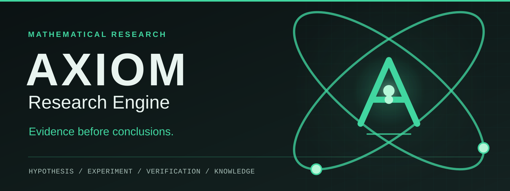
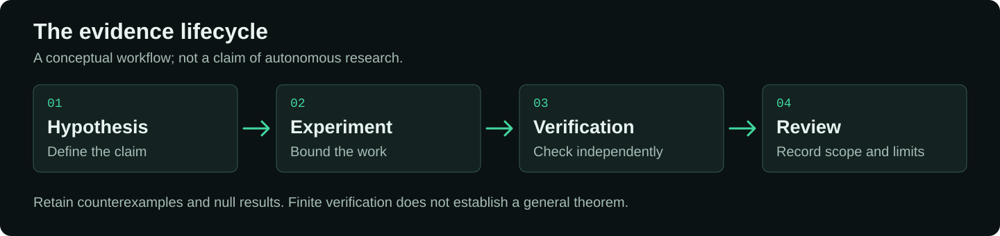

# AXIOM Research Engine



**Evidence before conclusions.**

Mathematical research software for exact SAT counting, structured permanents, weighted XOR walk aggregation, modular arithmetic and finite adaptive strategy experiments.

**Status:** v0.4.0 publication candidate · public bootstrap in progress · Python 3.11+ · no third-party runtime dependencies.

[Research portal source](docs/index.html) · [Scientific program](docs/Scientific_Program.md) · [Engineering contract](docs/Hosted_Engineering_Contract.md) · [Actions](https://github.com/amdecian/Axiom-Research-Engine/actions) · [Branding](branding/README.md) · [Startup animation](branding/axiom/identity/splash-preview.html)

> Research boundary: the engine is an experimental computational workspace. Finite verification does not establish a general SAT improvement, P=NP, or a formally verified autonomous research system. Public visibility is not a license grant.

## 01 / What AXIOM investigates

| Research area | Scope |
| --- | --- |
| Exact SAT counting | Reproducible exact assignment-count experiments |
| Structured permanents | Coefficient calculations and structured arithmetic |
| Weighted XOR walks | Equality patterns, quotient graphs and weighted aggregation |
| Modular arithmetic | Precision-aware exact arithmetic and CRT reconstruction |
| Adaptive strategy loop | Finite comparisons against fixed reference strategies and independently checked fixtures |

The [scientific program](docs/Scientific_Program.md) documents the mathematical baseline, implemented extensions, limitations and open research questions. The [engineering contract](docs/Hosted_Engineering_Contract.md) defines the hosted execution boundaries.

## 02 / Research workflow



Keep negative controls, counterexamples and null results. Distinguish a finite pass, an open question and a mathematical proof. Notebook entries are evidence-linked; a hash binds content, not publisher identity.

| Evidence and work | Where to look |
| --- | --- |
| Finite recorded results and replay evidence | [Evidence register](evidence/) · [Qualification scope](evidence/qualification-scope.md) |
| Evidence-linked statements | [Research notebook](research/notebook/) |
| Engineering work slices S001–S124 | [Engineering backlog](research/backlog.json) · [Work slices](docs/Work_Slices.md) |
| Scientific objectives R10–R29 | [Scientific backlog](research/scientific-backlog.json) |
| Public bootstrap and open administrative work | [Bootstrap checkpoint](docs/Bootstrap_Checkpoint.md) · [Master issue #1](https://github.com/amdecian/Axiom-Research-Engine/issues/1) |

Backlog entries are tracked objectives, not proof of implementation or completion. Imported evidence describes the original local candidate run; remote qualification is separately referenced below.

## 03 / Reproduce and verify

Python 3.11 or later; no third-party runtime dependencies. Run from the repository root:

```sh
python scripts/hosted.py --profile quick
python scripts/hosted.py --profile loop-replay
python scripts/hosted.py --profile portal-check
python scripts/backlog.py
```

[Recorded cross-platform core qualification](https://github.com/amdecian/Axiom-Research-Engine/actions/runs/46065480354) passed on Windows, macOS, Linux x64 and Linux ARM64. See [Actions](https://github.com/amdecian/Axiom-Research-Engine/actions) for current results rather than treating a historic run as the status of the latest commit.

Free-tier qualification checks the engine and generated portal. Bounded research regression is a manual finite replay. The [static portal source](docs/index.html) is included; enable GitHub Pages from `main:/docs` to serve it. Pages activation is an owner setting, not implied by the presence of the file.

## 04 / Repository map

| Location | Purpose |
| --- | --- |
| [`axiom/`](axiom/) | Python engine, mathematical algorithms, strategy loop and local dashboard |
| [`contracts/`](contracts/) | Schemas, worker protocol and interface contracts |
| [`research/`](research/) | Public plans, notebook and engineering/scientific backlogs |
| [`evidence/`](evidence/) | Recorded finite evidence and qualification scope |
| [`scripts/`](scripts/) | Qualification, portal generation, replay and publication gate |
| [`tests/`](tests/) | Mathematical, engine and governance regression tests |
| [`docs/`](docs/) | Scientific and engineering specifications, bootstrap and static portal |
| [`config/`](config/) | Hosted configuration |
| [`examples/`](examples/) | Example entry point |
| [`branding/`](branding/) | Working identity, reusable assets and retained alternative concepts |
| [`.github/`](.github/) | Workflow definitions and review templates |

## 05 / Publication and operating boundaries

- Public engineering and the separate private research workspace are distinct. Follow the [disclosure policy and exact-file gate](docs/Disclosure_Boundary.md). No private data or metadata may enter public CI.
- Use standard public GitHub-hosted runners for finite project testing, qualification and reproducibility only. No paid inference, self-hosted servers, scheduled discovery or routine artifact uploads. Owner billing controls require verification.
- The optional localhost dashboard, historical engineering documents, original three provisional branding concepts and capture script are included. The original R1–R9 executable archives, original binary replay archive and companion archive remain excluded.
- Licensing and ownership remain pending owner approval. Public visibility is not a software license grant. Do not submit confidential or employer-owned material.

See the [original setup guide](docs/GitHub_Bootstrap.md), [bootstrap checkpoint](docs/Bootstrap_Checkpoint.md), [contribution policy](CONTRIBUTING.md) and [security policy](SECURITY.md).

---

**AXIOM Research Engine** · Working identity; name and branding rights remain provisional. [Identity standards and assets](branding/axiom/identity/README.md).
