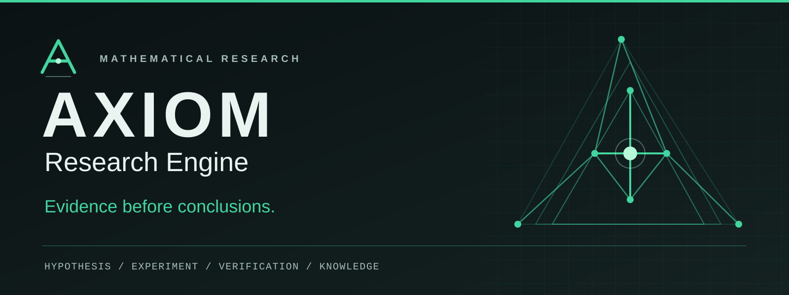

# AXIOM / Branding

The AXIOM emerald/graphite concept is the primary **working presentation** for this repository. It is not a trademark clearance, license grant or final identity approval.

## Identity kit

[Visual identity guide and assets](axiom/identity/README.md) · [Brand board](axiom/identity/brand-board.svg) · [Original AXIOM guide](axiom/BRAND_GUIDE.md) · [Theme tokens (JSON)](axiom/tokens.json) · [Theme tokens (CSS)](axiom/tokens.css)

The new vector kit is an evolution of the existing public concept. The original concept assets, tokens and all alternatives remain unchanged for historical traceability.

## Original concepts

| Concept | Direction | Assets |
| --- | --- | --- |
| AXIOM | Convergent vectors / emerald and graphite | [Guide](axiom/BRAND_GUIDE.md) · [Original banner](axiom/banner.svg) · [Original icon](axiom/icon.svg) |
| INVARIANT | Symmetry / navy and cyan | [Guide](invariant/BRAND_GUIDE.md) · [Banner](invariant/banner.svg) · [Icon](invariant/icon.svg) |
| ProofFoundry | Proof lattice / carbon and copper | [Guide](prooffoundry/BRAND_GUIDE.md) · [Banner](prooffoundry/banner.svg) · [Icon](prooffoundry/icon.svg) |

Use AXIOM in the repository presentation; do not mix concept families in one surface. Existing theme tokens remain the color authority. The static portal continues to use its existing neutral graphite and emerald styling; application integration is outside this branding-only change.

All names and public-use rights remain subject to owner approval. Historical visual boards remain in the separate review-only archive; no private assets were imported.
