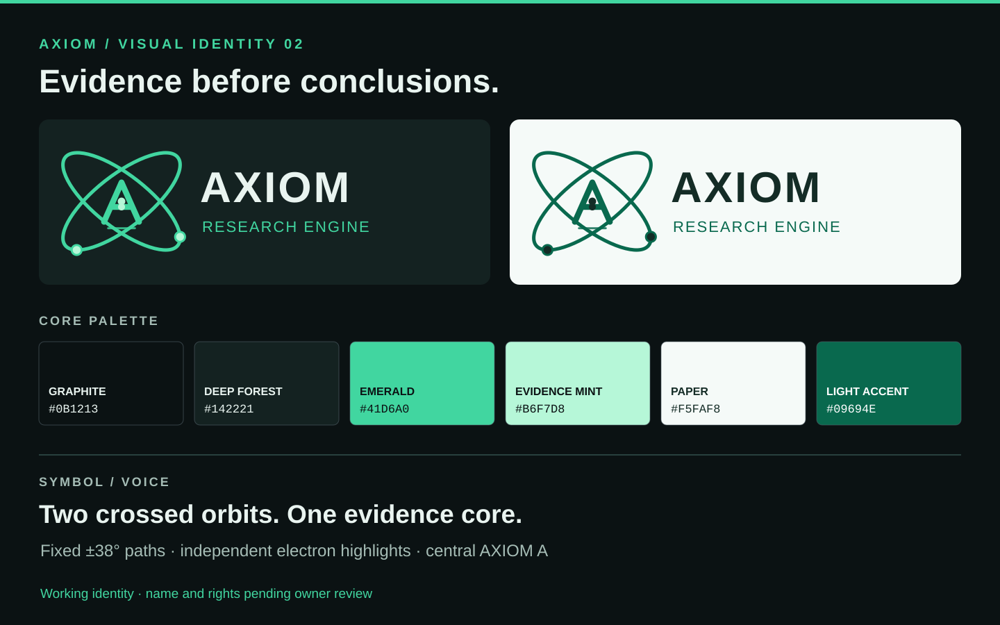
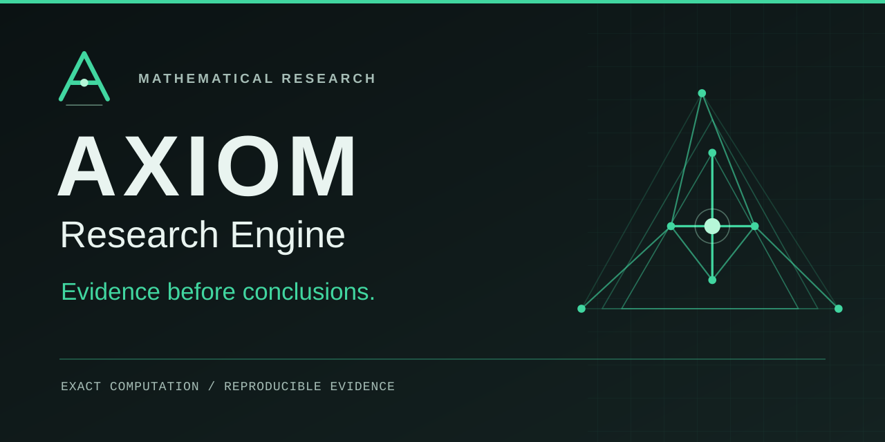

# AXIOM / Visual identity 01

**Working name:** AXIOM Research Engine  
**Descriptor:** Mathematical research engine  
**Tagline:** Evidence before conclusions.  
**Status:** Provisional working presentation, not trademark-cleared or a license grant.

## 1. Identity system

The geometric A is constructed from two convergent vectors, a crossbar and a central evidence node. The graph motif represents a conceptual progression from hypothesis to verification; it is not a plot, benchmark, proof or depiction of a specific mathematical construction. The new kit evolves the original public artwork without replacing its original files.

| Asset | Intended use | Dimensions / format |
| --- | --- | --- |
| [Repository banner](repository-banner.svg) | GitHub README and document cover | 1600 × 600 SVG (8:3) |
| [Dark wordmark](wordmark-dark.svg) | Dark presentations and documentation | 840 × 208 SVG |
| [Light wordmark](wordmark-light.svg) | Light presentations and documentation | 840 × 208 SVG |
| [Dark emblem](icon-dark.svg) | Dark UI, repository identity and avatar source | 144 × 144 SVG |
| [Light emblem](icon-light.svg) | Light UI and print layouts | 144 × 144 SVG |
| [Social artwork](social-card.svg) | Source for a manually exported social preview | 1280 × 640 SVG (2:1) |
| [Brand board](brand-board.svg) | Visual reference for maintainers | 1440 × 900 SVG |
| [Research flow](research-flow.svg) | Conceptual evidence lifecycle | 1440 × 340 SVG |

All vector assets are editable vectors with fixed viewBoxes, self-contained colors and descriptive titles. They contain no remote resources, embedded executable content or third-party marks.

  
  

## Startup experience / preview

[Playable offline splash source](splash-preview.html) · [Startup animation contract](splash-contract.md)

Download the HTML and open it locally in a browser (GitHub's file view displays source rather than executing it). The ten-second startup presentation uses two stationary crossed electron-style ellipses, each with a moving electron, the AXIOM wordmark, and a presentation-only timeline. The identical startup component is embedded in the localhost dashboard and generated static portal. The dashboard signals readiness after its existing read-only snapshot is rendered; the portal signals readiness after its existing initial view construction. The standalone preview does not run the engine.

## 2. Color and contrast

The original [JSON tokens](../tokens.json) and [CSS tokens](../tokens.css) are authoritative. The mint evidence node is a decorative brand accent, not a semantic status.

| Role | Dark | Light |
| --- | --- | --- |
| Background | `#0B1213` | `#F5FAF8` |
| Surface | `#142221` | `#FFFFFF` |
| Primary text | `#E9F4F0` | `#142C26` |
| Muted text | `#A6BDB6` | `#52616A` |
| Brand accent | `#41D6A0` | `#09694E` |
| Finite verification | `#64D9A1` | `#08764A` |
| Warning / open | `#F3C270` | `#805100` |
| Rejected / counterexample | `#FF9C9C` | `#A62229` |
| Running | `#89C9FF` | `#075A9B` |

Use the light green `#09694E` on paper; do not use bright emerald or evidence mint as body text on white. Target at least 4.5:1 contrast for ordinary text and 3:1 for relevant large text and non-text controls. Always add status text and, where appropriate, a shape or icon. A green check is not a proof certificate.

## 3. Typography and composition

- Use system-ui / Segoe UI / Arial for interface and document text; use system monospace for identifiers, hashes, code and exact arithmetic output. SVG artwork uses local Arial/Helvetica and monospace fallbacks; no fonts are distributed.
- Reserve wide letter spacing for short uppercase labels. Use sentence case for headings and technical explanations; use tabular numerals for comparisons.
- Preserve native asset aspect ratio and at least one evidence-node diameter of clear space around the emblem. Use the emblem alone below 160 px of available wordmark width; the intended minimum emblem size is 24 px. Never stretch or crop wordmark text.
- Keep graphics subordinate to the scientific content. No decorative status gradients, robot imagery, third-party logos or invented data visualizations.
- Prefer dark surfaces for branded headers; use the light wordmark for white documents. Supply meaningful alt text on all informative graphics; maintain keyboard focus and reduced-motion support in interfaces.

## 4. Repository layout standard

The root README starts with a single repository banner, a text title, concise scientific scope and research-status disclaimer. Navigation proceeds to research domains, evidence, reproducibility, repository map and governance. Keep run references explicitly historical unless they refer to the current commit. Avoid external badge trackers and remote images. All branding assets are local to Git; no Pages or CI settings are required to render the README.

The public static portal is generated from its existing template and research records; do not hand-edit generated output. The initial-page startup component is shared verbatim between the preview, dashboard and portal template. Preserve the existing portal data payload, light/dark theme controls, and dashboard refresh/navigation behavior.

## 5. Scientific and publication voice

Use precise terms such as "finite pass", "counterexample", "open", "recorded local run", and "independently checked fixture" where supported. A test pass is not an established theorem or a complexity bound. Never promote a research result to a proof through branding, color, labels or artwork.

Respect the [disclosure boundary](../../../docs/Disclosure_Boundary.md) and [contribution policy](../../../CONTRIBUTING.md). Do not import private research, employer assets or other unapproved material.

## 6. Distribution and review

For a GitHub social preview, export the social SVG to a 1280 × 640 PNG without stretching and upload it through the repository settings after owner approval. The vector is the source artwork, not an indication that social preview metadata has been configured. Check the crop and legibility in the target service before publishing.

Original concept files and alternate names remain under [branding](../../README.md). Treat this new kit as a working identity until ownership, licensing and name rights are approved. Do not claim trademark registration. Review banner rendering in GitHub light and dark modes, minimum-size icons, mobile readability and relative asset links before accepting a branding change. Preserve the prior Git revision for rollback.
