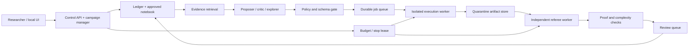

> Historical foundation retained; `Hosted_Engineering_Contract.md` supersedes conflicting hosting and publication requirements.

# AXIOM / Mathematical Research Engine
**Engineering specification and implementation contract · v0.1 · 2026-11-27**

Working title. Proposed local-first architecture, with an offline reference implementation delivered separately. This is a research tool, not a claimed solution of P versus NP.

## 01 — Mission, scope and evidence

**Mission.** Turn a manually guided mathematical investigation into a repeatable, evidence-driven discovery process. Models generate hypotheses and executable algorithms; independent referees test claims; durable memory preserves verified lessons and counterexamples; research campaigns stop when their approved budgets end. The system should reward reduction of total computational work, not simply the size of an impressive intermediate matrix or the number of attempts.

**Scientific starting point.** The user's 16-page paper, *Can shared arithmetic speed up SAT counting? Experiments on coefficients of structured permanents* (2026-11-27), investigates repeated minor permanents in a sparse-permanent interpolation reduction. Its small examples show that equal local entries need not imply equal completion weights; corrections can interact even when disjoint; reordering can be exhausted by cut-rank bounds. Its five-size experiment shares two-crossing arithmetic on structured translations at fixed precision; the most advanced matrix is 16,384 rows, with ten calculated base-11 digits and a pattern census through twelve. At ten digits the recurrence enumerates 167,712,948 interiors rather than 40,143,346,628 eligible walks, about 239 times less enumeration, not a measured 239x speedup. The paper reports no improved general SAT running-time bound (pp. 1–2, 6–15). The original R1–R9 archives are not present in this package; their results are paper-reported, pending replay and source hashes.

**Methodological starting point.** Blankline's `extrapolation-n26` uses a frozen model, external lessons, candidate program execution, a verifier and archived attempts. Its 91-attempt circle-packing run produced a structurally distinct packing, not the best published objective. Human LP and model-free post-processing contributed to the final score; tolerance-based floating-point validation is not a symbolic proof. The transcript warns that five parallel workers invented past failures when sharing an empty notebook (16:11–16:34). Adopt the verified-memory architecture, not the numerical scoring or the claim that novelty has been established. A shared notebook is not trusted simply because an agent wrote it.

| Requirement | Production success criterion |
|---|---|
| R01 Evidence integrity | Every accepted assertion traces to immutable input, code, verifier, result and approval digests. |
| R02 Scientific validity | Correctness gates run before ranking; a finite pass never changes into a theorem. |
| R03 Bounded autonomy | Explicit campaign start, enforced spend, CPU, RAM, wall-clock and attempt limits, pause/stop and no automatic restart. |
| R04 Reproducibility | An offline replay using the recorded environment and seed reproduces exact results; timing drift is separately reported. |
| R05 Generalization | Independent holdouts include signed, asymmetric, higher-order and end-to-end SAT inputs. |
| R06 Privacy | Private project by default; no uploads, provider transfer or publishing without a reviewed policy. |
| R07 Usability | Dashboard shows status, evidence, counterexamples, budgets, stop controls and work slices. |

**Non-goals.** Do not claim guaranteed discovery, solve P versus NP by empirical testing, infer model training data from self-reports, or treat score maximization as proof. Do not silently run code, install services, publish source, or reuse a private credential. A formal proof may establish only its exact statement and assumptions; a faster algorithm on a restricted family does not imply a worst-case improvement.

## 02 — Architecture and deployment boundaries



Three planes: **control** (API, identity, campaign state, budget reservation), **execution** (untrusted candidates in isolated ephemeral guests), **evidence** (trusted independent verifiers, content-addressed blobs, append-only event ledger and reviewed notebook). Candidate workers never have direct access to the ledger, private holdouts, provider keys, verifier source, host filesystem or internet. The control API supplies a narrow run envelope and collects output through a validated size-bounded channel. The evidence plane signs verdict receipts; a human review can admit facts, not override mathematical failure.

| Component | Proposed implementation and responsibility |
|---|---|
| Local UI | HTML/CSS/TypeScript or React after prototype; REST + read-only event stream; dark default, accessible light theme. |
| Core API | Python service, Pydantic-like schema validation, OpenAPI versioning; CLI shares policy checks, not privileged bypass. |
| State store | SQLite for single-user pilot, PostgreSQL for multi-user; WAL/transactional outbox, schema migrations, role-based writes. |
| Artifact store | Filesystem SHA-256 blobs in pilot, object storage later; immutable object name, manifest, retention class, encryption and restore. |
| Orchestrator | Durable leases, idempotency key, cancellation token and quota ledger; no unbounded retry loops. |
| Agent gateway | Provider-neutral adapters; typed proposal/review only; explicit network opt-in; no execution permissions. |
| Worker pool | Ephemeral Linux VM/microVM recommended for hostile code; rootless container only for lower-trust bounded internal code, never sole hardened boundary. |
| Verifier | Separate image, identity and filesystem; oracle and adversarial fixture suite pinned before a run. |
| Formal proof | Lean kernel checking in a separately pinned environment; reject unexpected axioms, `sorry`, unreviewed imports, statement drift. |
| Observability | Structured events and metrics: no secret or raw hidden test payload in agent logs. |

**Deployment choices.** Phase A: single-machine offline fixture runner, current starter. Phase B: private local research server on a dedicated machine, Linux guest workers; Windows clients use browser/CLI, not direct execution on engineer PCs. Phase C: optional multi-user controller + remote worker pool, independent identities, encrypted transport. No cloud or SaaS dependency is required except an explicitly configured model provider; model requests must be scoped to allowed source classes. Model outputs are untrusted data. Local inference is an optional adapter.

## 03 — Research workflow and state contracts

Campaign is a bounded search over a declared scientific question, baseline, objective and holdouts. Every attempt has an immutable parent, selected strategy, input set, limits, code digest and reproducible seed. An experiment may test a new identity, implementation, counterexample, proof, or asymptotic claim; not every experiment is a speed competition.

| Stage | Contract / resulting record |
|---|---|
| 1. Design | Research brief, exact domain, hypotheses, acceptance oracle, baseline, allowed artifacts, budget and stop conditions. |
| 2. Review & authorize | Human approves a hash of the immutable campaign manifest; no execution by creating a draft. |
| 3. Retrieve | Frozen notebook snapshot filtered by workstream, relevance, evidence grade and exclusions. |
| 4. Propose | Model submits structured claim, assumptions, prior evidence references, technique novelty and candidate code hash. |
| 5. Critique | Independent critic seeks missing cases, signed/asymmetric examples, hidden complexity, and changed quantifiers. |
| 6. Gate & execute | Validate schema, reserve budget, issue short lease; worker runs in quarantine; resource limits are external to candidate. |
| 7. Verify | Independently derive expected outputs; compare exact results, replay, check receipt; timeouts/errors are not UNSAT. |
| 8. Rank & review | Only valid candidates ranked on pre-registered comparable metrics; rejected attempts retained. |
| 9. Promote | Evidence-linked lesson approved through a separate review; append event, never overwrite history. |
| 10. Continue or stop | Retrieve next approved snapshot; stop for exhausted budget, plateau, repeated failure, cancellation or missing verifier. |

Campaign states: `DRAFT -> REVIEW_REQUIRED -> READY -> RUNNING -> STOPPING -> STOPPED`; alternative terminal `COMPLETED`, `FAILED`, `EXPIRED`; `RUNNING -> PAUSING -> PAUSED -> READY` requires explicit resume authorization and fresh budget lease. Attempt states: `PROPOSED -> CRITIQUED -> VALIDATED -> QUEUED -> RUNNING -> OUTPUT_READY -> VERIFYING -> VERIFIED | REJECTED | INCONCLUSIVE`; failure/cancel/timeout terminal states have reason and receipt. Review/promotion is separate from experiment completion. No agent can set campaign `READY` or an attempt's final verifier verdict.

**Recovery rules.** Queue delivery may be at least once; persist the attempt id + execution token and deduplicate terminal receipts. After a crash, expire leases; reconcile or kill orphan workers; preserve incomplete runs; never resume automatically. Pause stops dispatch; stop revokes leases and terminates all descendants; mark incomplete outputs quarantined. At budget expiry the controller blocks new work and terminates over-budget work. Distinguish a complete negative mathematical result from failure to compute.

## 04 — Agent contracts and persistent notebook

| Role | Inputs | Outputs and restrictions |
|---|---|---|
| Planner | Approved research brief and snapshot | Bounded candidate portfolio; no authority to start. |
| Proposer | Technique list, evidence, domain and objective | Typed hypothesis with assumptions, algorithm, falsification plan, references; no direct shell. |
| Critic | Proposal and approved context (separate conversation) | Counterexample specification, possible complexity trap, reject/advise; cannot forge observations. |
| Explorer | Literature and technique catalog | Alternative representation, e.g. generating functions, tensor networks, p-adic arithmetic; cite sources. |
| Implementer | Approved proposal, SDK, sandbox permissions | Content-addressed code + manifest; tests on public dev fixtures only. |
| Referee | Frozen verifier, private holdouts, candidate output | Signed verdict, comparisons, exact witness, resource metrics. Non-LLM authority. |
| Proof / complexity analyst | Precise statement, proof candidate and costs | Proof obligations and audited bounds; formal status only from trusted kernel receipt. |
| Archivist | Receipts and review decision | Draft lessons tied to immutable evidence; append only after approval. |

**Memory semantics.** Separate raw attempt logs, candidate assertions, evidence receipts, and approved lessons. Memory record contains lesson id, claim, scope, assumptions, provenance digests, status, counterexample if relevant, reviewer, revision parent and timestamp. Grades: `hypothesis`, `finite_pass`, `counterexample`, `derived_pending_review`, `derived_reviewed`, `formal_checked`, `superseded`. A counterexample falsifies the stated universal claim only within its stated domain; a finite pass certifies that fixture set only. A derivation requires review; formal check identifies kernel, pinned environment, theorem hash and axioms. Never store a model's unsupported introspection as established fact.

**Retrieval.** Match topic, mathematical objects and tags; prioritize verified counterexamples and explicit constraints, then recent reviewed derivations, then finite passes. Return source IDs and snapshot hash, not invented summaries. Similarity search is an index, not evidence. Workers start from a frozen snapshot, produce proposed lessons separately and merge serially after validation. Two agents cannot claim a nonexistent predecessor event; optimistic version check rejects stale writes. Superseding a mistaken lesson appends a correction event; historical results remain available. Test with shuffled memory, no-memory and stale/malicious notes.

**Plateau policy.** Start with 3 independent proposals per round, bounded diversity slots: incumbent refinement, cross-field technique, and adversarial simplification. If no registered metric improves over five accepted attempts (tunable), halt or ask reviewer to fund a new approach. Prefer a candidate that changes the representation rather than endlessly optimizing loops. Reserve 20% of approved attempts for disconfirmation and 20% for novel technique families as initial proposed defaults, not measured optima.

## 05 — Mathematical adapters and experimental design

A problem adapter is a versioned contract: input schema, exact output schema, oracle, admissible domains, fixture generator, baseline, objective, proof obligations, resource accounting and validation policy. Candidate program must not see hidden answers. Its stdout is a bounded JSON result only; diagnostics are separate. A negative result is never inferred from crash or timeout.

**Adapter A: SAT / #SAT.** Input `n` nonnegative, ordered CNF clauses of signed nonzero integers within 1..n; empty CNF has 2^n satisfying assignments; empty clause makes zero; duplicate literals and tautologies handled exactly. Output integer count encoded decimal string (avoid JSON float truncation), or SAT/UNSAT with witness/certificate in decision adapter. Oracle exhaustive enumeration for small n, independent DPLL/compiled counting baseline for larger cases, certificate-based checks where available. Compare free variables, all 2/3-SAT cases at manageable n, disconnected components, planted and UNSAT controls, signed/asymmetric reductions. Do not compare decision solver time directly to exact counting time as the same task.

**Adapter B: coefficient engine.** Input exact rational matrices B,T,H and order q, or a pinned construction manifest for A(t), interpolation node a and truncation h. Output exact coefficient vector in Q or residues with modulus and proven precision. Start from identity `[z^2]per(B+zT+z^2H)=H1+T2`; sum H edges and pairs of T edges with distinct rows and columns, multiplying surviving minors. Independent permutation polynomial oracle checks n small, including the counterexample to omitting H. Test low-rank completion, disjoint interacting corrections, signed minors, zero entries with nonzero cofactors, and block retirement invariants. The delivered starter implements this quadratic identity, not the complete sparse-permanent SAT reduction.

**Adapter C: structured translation precision.** Register R6–R9 when supplied; preserve exact source matrices, bit convention, node, tolerances and moduli. Independently reproduce reported results including 756 distinct squares, 25 two-edge group saturation, ten-digit residue U=12,818,998,701 modulo 11^10 and decimal suffix 621 (paper pp. 9–14). These are paper-reported targets; not rerun here. First reproduce small controls before full matrix work. Separate eligible walk count, interiors, correction terms, convolutions, memory and bit costs. For a rational term a/b with v_p(b)=d, a modular inverse of b is invalid if d>0; retain enough p-adic precision after cancellation or use integer-valued recurrences. Synthetic 5408/11 rejection is a required adversarial case. Do not simply divide residues by 11.

**Adapter D: end-to-end SAT reduction.** Accept arbitrary sparse degree-three matrix gadgets and original CNF; check reduction factor, sparsification accounting, every interpolation node and coefficient order, signed arithmetic, denominator recovery and total bit cost. CRT reconstructs final nonnegative count only when combined modulus >2^n and the reduction is valid modulo each modulus, including nonunit factors. SAT can be established by nonzero final count residue; zero residue alone is not UNSAT. Record baseline and all conversion overhead. Primary goal: improve total worst-case counting bound, not one intermediate calculation.

**Candidate priorities.** First avoid enumerating all physical interiors using shared generating functions or recurrence state compression; test higher crossing/Taylor orders; retain exact arithmetic under nonunit denominators; transfer to weighted sums of restricted translations and asymmetric instances; derive bounds covering group discovery and evaluation. Compute an additional base-11 digit only as validation, not as the sole objective.

## 06 — Referee, metrics and scientific controls

Correctness is a hard gate; score is undefined for invalid or inconclusive output. Use three independent oracle levels: exact small-instance enumeration, alternate implementation for medium instances, and theorem/certificate checks for general claims. For signed rational inputs, compare reduced rational numbers, not float tolerances. Check dimensions, literal ranges, canonical rational representation, nonnegative counts, overflow, and all result fields. Seed private holdouts independently before candidate generation and keep them in a verifier-only store. Publish digest commitments; periodically rotate holdouts under reviewed policy. No private fixture values in prompts, logs or candidate feedback beyond a sanctioned minimized counterexample.

For performance comparisons, fix workload, implementation version, hardware, thread count, warmups, repeat count, seeds, compiler and precision. Record total end-to-end wall-time, CPU seconds, peak RSS, arithmetic counts by operation type, bit lengths, IO, preprocessing, verifier cost separately and failure rate. Compare medians and spread across repeats, not cherry-picked fastest result. The starter reports different instrumentation units for oracle and candidate; they are not comparable speedups. On small workloads timer noise dominates.

**Ranking proposal:** feasibility first (all required exact checks pass); then Pareto frontier for end-to-end median runtime, peak RSS, operation counts and scope. A candidate with a narrower domain is not automatically better. Require repeatable paired improvements on identical holdouts before promoting a performance claim. Track model tokens and spend separately, with all failed attempts included. Never optimize only the verifier's public examples.

**Control arms:** same provider/model, token/time/compute cap, seeds and problem distribution: A memory-on, B memory-off, C shuffled irrelevant notebook, D conventional algorithm without model; repeat independently, retain all attempts. Match budget including model-call costs and post-processing, and label human intervention separately. Report failures and null results. A proof claim requires a written derivation or trusted proof checker, no empirical statistical extrapolation. Complexity obligations quantify n,m,N,h, rank, width, k, coefficient bit length, precision, interpolation/reduction and candidate preparation costs.

## 07 — Control API, storage and security

The `contracts/` directory specifies v1 target schemas: campaign manifest, hypothesis, job envelope, result receipt, memory lesson and OpenAPI endpoints. Prototype API is only `GET /api/v1/snapshot` and `GET /`; all other endpoints are planned. API requests use authenticated principal, request ID, schema version and idempotency key for mutations. Return 409 on state/version conflicts; 422 on invalid envelope; 403 on role/policy denial; 429 on quota; never leak private test vectors. Authorization scopes: researcher drafts, operator starts/stops, verifier signs, reviewer approves lessons, admin manages infrastructure, publisher exports approved public artifacts. Dual control for enabling unattended operation or widening provider data policy.

**Storage model:** project -> campaign -> attempt -> execution -> artifact and receipt; hypothesis and proof records separately; notebook lessons reference receipts; event ledger spans all transitions. SHA-256 canonical JSON event chain, content hashes, verifier signatures, signed checkpoints anchored outside writable project storage. SQLite prototype uses transaction + hash chain + no-update/no-delete triggers, not an immutable or cryptographically authenticated service. Production enforce uniqueness on idempotency keys, attempt terminal receipt and active approval; use transactions around budgets/leases/state and approval snapshot. Replay does not overwrite originals; all derived output stores parent hash. Store raw code/logs in bounded quarantine, reviewed artifacts in durable evidence, and credentials outside both. Backup with encryption, point-in-time restore, integrity verification and separate keys; retain failed attempts by approved retention policy, redact private data from publication without changing raw hashes.

**Execution threat model.** Treat generated code as hostile, including access to host credentials, verifier gaming, path traversal, dependency downloads, fork bombs, exfiltration, hidden-test inference and memory poisoning. Separate controller and worker accounts, no Docker socket, no privileged mode, no host or secret mounts, read-only image, scratch-only filesystem, network deny, cgroup/VM CPU-memory-PID caps, hard external deadline and kill process tree. Validate output size/schema; reject symlinks, archive traversal and executable artifacts in review UI; render strings as text. Pin images by digest and dependencies by lock/hash; scan dependencies and SBOM; sign release manifests; independently test escape and kill scenarios. Do not run generated code on a sensitive workstation or with production credentials.

**Provider security.** Credentials scoped to gateway, never prompt or worker. Offline by default. Data classification gate per retrieval and provider; explicit allowed domains and model endpoints; project-specific secrets, redaction and retention. Check vendor terms and retention before sending nonpublic research. No training/retention promises inferred from marketing. No network from verifier or candidate. No repo write, external publishing, self-updating code or cron/service install by default.

**Proposed default campaign limits** (user configurable within admin maxima): 3 attempts for smoke, 12 attempts for exploratory campaign, 300 s per candidate, 2 GiB RAM, 2 CPU cores, 32 processes, 16 MiB stdout+stderr, 256 MiB artifacts, 30 min aggregate wall-clock, $5 provider maximum after explicit opt-in; provider spend zero offline. Before start reserve estimated worst-case provider cost and enforce call/token cap; stop on reservation failure. No auto renew, restart or scheduling. Defaults are design decisions, not current implemented quotas. Separate trusted fixture runner has only max-attempts 1–3 and bounded tiny inputs; no sandbox.

## 08 — User experience and operational controls

Dark graphite/teal working identity (not company branding). Responsive desktop-first research console; keyboard navigable, screen-readable labels, accessible contrast, light mode planned. Main navigation: Overview, Campaigns, Experiments, Verified Notebook, Verification, Work Slices, Controls. Target additions: Research Graph, Proof Workspace, Benchmark Explorer, Provider & Workers, Audit & Export. Each view shows project, campaign, version, trust status and whether automation is disabled/running. Never use an unlabeled green status to imply proof.

| View | Required controls / wireframe behavior |
|---|---|
| Overview | Counts by evidence grade, active campaign and resource budget, stop control pinned, latest receipts, research objectives. |
| Campaign builder | Problem adapter, baseline, hypothesis scope, test plan, seed, provider, budget, isolation, dry-run review; start requires approval of manifest hash. |
| Live execution | Timeline, queue leases, active candidate, elapsed and cost, logs, cancel attempt / stop campaign; no sensitive prompt data. |
| Experiment detail | Candidate vs oracle results, exact counterexample, input and code hashes, resource metrics, replay command, reviewer action. |
| Notebook | Filters by topic/grade, linked evidence, conflicting claims, proposed corrections; approve or reject with reason, no inline editing of history. |
| Verification & proof | Exact pass coverage, hidden-suite commitment, formal theorem statement/axioms, checker receipts, complexity obligations. |
| Benchmark explorer | Paired runs, precision vs work, bit cost, breakdown by phases; warn about incomparable metrics. |
| Work slices | Dependency DAG, acceptance gates, linked commits/tests, blocked status and export. |
| Controls & audit | Provider OFF/ON, local workers, allowlists, quota and schedule disabled, kill switch, export approval, backup/recovery. |

Prototype UI is read-only and loads actual fixture evidence; seven views and local JSON API. It has a manual refresh button and CLI setup/approval instructions. Production controls (start/pause/stop, proof UI, provider management, RBAC) are deliberately not wired in this starter. See embedded screenshots and standalone preview.

## 09 — Source architecture, release and acceptance

```
axiom-research/
  axiom/                 # trusted offline reference implementation
    __main__.py          # bounded demo, audit, approve, snapshot, serve
    algorithms.py        # independent SAT/coeff oracles + candidate registry
    store.py             # append-only SQLite event chain
    dashboard.html       # read-only UI with local API
  contracts/             # proposed v1 production JSON/API contracts
  docs/                  # engineering spec, 48 slices and screenshots
  tests/                 # deterministic unit tests
  examples/              # measured smoke run, sample evidence, preview
  README.md
```

Production expand to `services/control`, `services/gateway`, `services/verifier`, `workers/`, `adapters/`, `proofs/`, `web/`, `migrations/`, `infra/`, `benchmarks/public/`, private fixture store outside Git, `docs/adr/`, `release/`. Use feature branches `slice/Sxxx-description`; every PR links slice, contract version, tests, threat-model changes and replay recipe. Protected main, independent review, no force push, secret scanning, dependency review and pinned CI. CI hosted build/test for non-secret work, dedicated hardened self-hosted worker only after isolation qualification. Do not package raw provider keys, private fixtures, or personal research archives into a public release. Store durable build packages outside expiring CI artifacts, record SHA-256, SBOM, signing identity, immutable source revision. No changes to external repos were made.

**Release gates:** G1 offline exact verifier and ledger; G2 isolation/budget/stop; G3 agent and reviewed memory; G4 original research replays and generalization; G5 formal proof and full cost accounting; G6 usable controlled pilot. Each gate requires regression tests, negative controls, evidence artifacts, review and documented limitations. 48 slices in `Work_Slices.md`. Slices are proposed, not completed merely because specified. A production autonomous run is not authorized until G2/G3 pass and a user explicitly approves a campaign.

**Starter acceptance (executed):** 14 unit tests; 80/80 SAT fixture comparisons; 36/36 coefficient fixture comparisons; 0/36 for omission of H on first witness (expected 2, actual 0); ledger audit PASS; 7 view browser navigation, counterexample selection, mobile overflow check and local snapshot API check passed. No original R1–R9 archive replay, model API integration, independent production reviewer, hardened sandbox, formal proof or end-to-end general SAT improvement is claimed. The sample notebook approvals are test actions, not user approvals.

## 10 — Source and design traceability

- User research paper, *Can shared arithmetic speed up SAT counting? Experiments on coefficients of structured permanents*, 2026-11-27: pp. 1–4 reduction and pilots, 5–8 rank/overlap/sharing, 9–14 precision, 15–16 proof obligations and archive index.
- User-provided `transcript.txt`, video *AI Found Something It Shouldn't Be Able To Find*: 5:35–6:12 loop, 8:02–11:25 plateau and alternate optimization, 15:21–16:40 limitations and false memory, 17:13–18:51 controls. The video contains marketing and other unrelated claims; these are not relied upon.
- Blankline GitHub repo `blankline-org/extrapolation-n26`: README, `loop/README.md`, `verify.mjs`, `contact-graph.mjs`, `control/README.md`, `results/report-independent.md` reviewed earlier in this conversation. It is inspiration, not code copied into this package. License as documented by upstream: MIT. Their verifier is numerical, with a tolerance, and their run is an existence example. We have not rerun it.
- Proposed design choices (architecture, work slices, API, quotas, working name, technology stack) are engineering recommendations, not source-derived research results. Independent external literature review and novelty assessment are future work.
